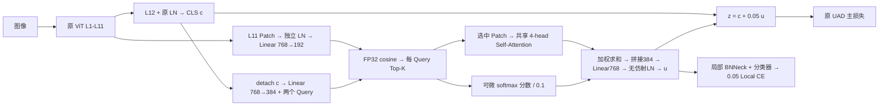
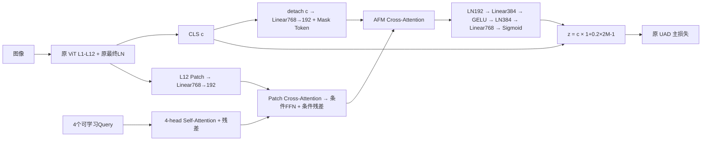

# UAD + A1/A2 实现说明与验收记录

本实现对应工作区 `idea` 的实施版 V1.0。Baseline、A1、A2 是三个独立运行模式；一次运行只创建所选分支。`FEATURE_AUG.TYPE=none` 仍默认使用原 UAD 的 CE + WRT + ProCA + GPD，不等于 `SOLVER.LOSS_TYPE=base`。

## 论文依据与适配边界

逐项以提供的 PDF 为方法依据，再检查本地参考代码。方案中的明确简化优先用于本次实验；未指定的实现细节采用对应论文的 Transformer 结构。

| 依据 | 论文方法 | 本次实现 |
| --- | --- | --- |
| WHU §4.2–4.5，Fig.3 | 单分支、共享 BNNeck、CE/WRT、两级中心与全局原型 | 保留原函数、数据排列、损失权重和 EMA 时序，用最终 z 替换原 CLS |
| ViSA §3.3 ETGM、§3.4 DLFM、Eq.8–13 | 专家 Query、相似度 Top-K、Query 增广图与 GCN、全局/局部融合 | A1 用两个 CLS 条件 Query、独立 Top-K、共享一层 Patch MHA、连续分数加权、局部残差 |
| ViSA §3.5、Eq.20 | 全局/局部 CE 和 Triplet，视角与专家正则 | A1 只增加 0.05 × Local CE |
| QVAM §3.2、Eq.1，Fig.2(b) | Query Self-Attention → Patch Cross-Attention → FFN | A2 用一层、4 Query、192 维；Cross-Attention 后不加回原 Query |
| QVAM §3.3、Eq.3–5，Fig.2(c) | CLS 条件 mask token，读取视角 Query，Sigmoid 调制 | A2 用 detach CLS 条件，读取 Patch 条件 Query，不加回 mask 读取 Query，改成有界残差缩放 |
| DeCLIP §3.1–3.2、Eq.4–10，Fig.5 | 最后一层 QQ 关系、内容/上下文双教师蒸馏 | 仅作“局部内容与关系分别处理”的辅助依据，未添加 QQ 替换、教师、CLIP 或蒸馏损失 |

本地代码核对位置：

- `../ViSA/fastreid/modeling/backbones/vision_transformer_multiview_ViSA.py`：末层前 token、ETGM、Top-K、图学习。
- `../ViSA/fastreid/modeling/meta_arch/baseline_multi_view_ViSA.py`：局部身份监督。
- `../QVAM/fastreid/modeling/QVAM/QVAM.py`：VAD/AFM 与初始化。
- `../QVAM/fastreid/modeling/meta_arch/baseline_multi_view.py`：原方法的多项监督与双视角原型。
- `../DeCLIP/src/open_clip/transformer.py`、`../DeCLIP/src/training/declip.py`：最后一层关系改造、内容和上下文蒸馏。

不能把 A1/A2 称为原 ViSA/QVAM 的完整复现，也不能把 DeCLIP 在 CLIP 中的观察直接当作已经在 UAD 中验证的事实。ViSA 的 Eq.4 将身份互信息写为 minimized，而附近文字描述为最大化；本实验遵循身份 CE 的明确监督设计。ViSA 本地代码的图构造包含 `no_grad()`，本次按方案保留分数与 Patch 聚合的梯度，未复制这一实现。

官方入口交叉核对：[WHU-MARS](https://github.com/msm8976/WHU-MARS)、[ViSA](https://github.com/Cat-Zero/ViSA)、[QVAM](https://github.com/Sakuraandroxy/QVAM)、[DeCLIP](https://github.com/xiaomoguhz/DeCLIP)。本次以工作区 WHU 为训练/评测协议基准。

## 文件变更清单

| 文件 | 类型 | 功能、目的与关键细节 |
| --- | --- | --- |
| `config/defaults.py` | 修改 | 声明 FEATURE_AUG 的全部字段与 SOLVER.RESUME；默认 none |
| `model/backbones/vit_pytorch.py` | 修改 | 单次前向可返回 L11 未经最终 LN 的 Patch，或 L12 最终 LN 后的 Patch；不改变 CLS。ImageNet 加载保留位置插值和旧 Patch 权重转换，并拒绝非预期漏加载 |
| `model/make_model.py` | 修改 | 按模式实例化分支、计算 z；A1 独立局部 BNNeck/分类器；统一训练字典；推理 Tensor 和 mode 参数不变；加载元数据 |
| `loss/make_loss.py` | 修改 | 将主 CE 的真实 criterion 暴露为 `loss_func.id_criterion`，供局部 CE 复用；原主损失公式不变 |
| `processor/processor.py` | 修改 | 读取训练字典；仅 A1 加局部 CE 与日志；在原模型权重之外保存完整训练状态；严格续训 |
| `train.py` | 修改 | 校验 resume 配置；原 CUDA_VISIBLE_DEVICES、torchrun/NCCL、rank 设置保持 |
| `test.py` | 修改 | 测试直接严格加载整模型，不再依赖 ImageNet 预训练文件 |
| `model/modules/__init__.py` | 新增 | 导出两种独立分支 |
| `model/modules/common.py` | 新增 | 显式初始化 Linear、MHA 的 in/out projection、LayerNorm；维度检查 |
| `model/modules/a1_local.py` | 新增 | 可微分数加权的局部身份增强 |
| `model/modules/a2_modulation.py` | 新增 | Patch 条件提取、Mask 读取和有界调制 |
| `utils/checkpoint.py` | 新增 | 严格共享参数迁移、同结构加载、元数据、完整状态保存/恢复 |
| `configs/UAD_A1.yml` | 新增 | 复制原 UAD 配置，仅新增 A1 字段和独立输出目录 |
| `configs/UAD_A2.yml` | 新增 | 复制原 UAD 配置，仅新增 A2 字段和独立输出目录 |
| `tests/test_feature_aug.py` | 新增 | 基线逐元素回归、真实 ViT 集成、梯度、初始化、优化器、加载与续训验收 |
| `tests/ddp_feature_aug.py` | 新增 | 两 rank 的 DDP 参数/原型同步、连续迭代、不同推理次数、rank 状态恢复验收 |
| `tools/check_feature_aug.py` | 新增 | 两分支各 50 次合成优化，输出 Mask/范数/梯度诊断；不是数据集精度试验 |
| `IMPLEMENTATION_A1_A2.md` | 新增 | 本说明 |

未删除原有源文件。原 `configs/UAD.yml`、数据集与 transforms、两个 PKM sampler、`utils/metrics.py`、`solver/make_optimizer.py` 保持原文件；ProCA、GPD、PrototypeBank 的实现保持原函数。优化器继续自动收集注册参数，没有增加新学习率策略。

工作区无 Git 元数据，修改前快照与 SHA256 清单位于 `../tmp/uad_original/`，用于本次原版回归。PDF 阅读缓存与隔离 DDP 测试环境位于 `../tmp/`，不是模型运行依赖。

## A1 架构与梯度



默认输入 256×128、Patch/stride 16，N=128；代码不写死 N。第 11 个 Block 是 `blocks[10]`，Patch 不 detach，不复制第 12 层。每个 Query 选择 `min(16,N)` 个位置，两组允许重叠，无额外多样性损失。

\[
\widetilde P=W_p LN_{11}(P_{11}),\quad Q=Q_0+reshape(W_q\,sg(c))
\]
\[
s_{ji}=cos(q_j,\widetilde p_i),\quad a_j=softmax(TopK(s_j)/0.1)
\]
\[
H_j=V_j+MHA(LN(V_j)),\quad h_j=\sum_i a_{ji}H_{ji}
\]
\[
u=LN_{\text{no affine}}(W_o[h_1;h_2]),\quad z=c+0.05u
\]

Top-K 索引不可微，选中分数参与 softmax 后可微。余弦矩阵乘法和 softmax 显式关闭 autocast 并在 FP32 计算，然后转换权重为 Value dtype。最终 Value 来自 Patch，Query/CLS 未被直接拼进 u。`detach(c)` 仅切断条件读取对 CLS 的直接反传；Patch 与 CLS 共用主干，因此不意味着统计独立或完全阻断共享主干梯度。

普通投影、MHA in/out 投影和 Query 使用截断正态 std=0.02，bias=0；独立 LN 为 weight=1、bias=0。局部 BNNeck/分类器沿用原 UAD 初始化规则。A1 分支参数 889,152；500 个身份时，加上局部 BNNeck/分类器共新增 1,274,688 个参数（其中局部 BN bias 768 个参数冻结）。

## A2 架构、初始化与边界



精确缩放公式为：

\[
Q_s=Q_0+SelfAttn(LN(Q_0)),\quad Q_{read}=CrossAttn(LN(Q_s),\widetilde P_{12},\widetilde P_{12})
\]
\[
Q_{cond}=Q_{read}+FFN(LN(Q_{read})),\quad m_0=m_{learn}+W_c\,sg(c)
\]
\[
m_{cond}=CrossAttn(LN(m_0),Q_{cond},Q_{cond})
\]
\[
M=\sigma(W_2 LN_{384}(GELU(W_1 LN_{192}(m_{cond})))),\quad
z=c\odot[1+0.2(2M-1)]
\]

VAD 采用论文中的 FFN，轻量化为 192→384→192，残差仅作用于已经读取 Patch 的条件；没有 `Q_s + CrossAttn(...)`，也没有 `m_0 + CrossAttn(...)`。AFM 不额外复制 QVAM 的第二次 Query Self-Attention、多层循环或最终增强 FFN，按方案固定的简化路径实施。

普通层与 MHA 的所有投影、Query/Mask Token 为截断正态 std=0.02、bias=0；LN 为 weight=1、bias=0。Mask 最后一层覆盖为 Normal(mean=0,std=0.005)，bias=0，避免零初始化切断上游初始梯度。Sigmoid 使缩放有界于 [0.8,1.2]。A2 共新增 1,261,440 个参数，没有局部分类头。

CLS 仍可通过注意力权重影响 Mask。Value 路径来自 Patch 条件，不保证这些条件一定具有有用的视角语义；需要真实数据消融证明。

## 损失、输出与协议

\[
\mathcal L_{UAD}(z)=\mathcal L_{CE}(Classifier(BN(z)),y)
+\mathcal L_{WRT}(z,y)+0.01\mathcal L_{ProCA}(z)+\mathcal L_{GPD}(z)
\]
\[
\mathcal L_{A1}=\mathcal L_{UAD}(z)+0.05\mathcal L_{CE}(LocalClassifier(LocalBN(u)),y)
\]
\[
\mathcal L_{A2}=\mathcal L_{UAD}(z)
\]

CE 与 WRT 的可配置权重仍使用原 `ID_LOSS_WEIGHT` 和 `TRIPLET_LOSS_WEIGHT`，以上为 UAD.yml 默认值。原 ProCA/GPD 开关继续由 `SOLVER.LOSS_TYPE` 控制。

训练 `mode=0` 返回 `cls_score/global_feat/bn_feat/local_feat/local_score` 字典，其中 `global_feat=z`；Baseline/A2 的后两项为 None。外部自定义训练脚本若原来解包三个 Tensor，需要改为读取字典。官方单卡/DDP processor 已同步适配。

模态顺序仍为 RGB、IR、Thermal，各模态 batch 在第 0 维拼接；所有身份 CE 使用 `target.repeat(num_modalities)`。WRT、ProCA、GPD 全部使用 BN 前 z。主 CE 使用 BN(z)。GPD 的原型更新仍在反传、裁剪、优化器/Scaler 更新之后，DDP 原型更新仍使用原 all_gather。

推理 `mode=1/2/3` 返回 Tensor。`NECK_FEAT=before` 返回 z，`after` 返回 BN(z)。归一化、同相机排除、跨模态/平台子协议等仍由原 evaluator 处理。每张图像仍使用一次主干前向。

## 权重加载与完整续训

- `imagenet`：复用原位置插值/Patch 形状转换；仅允许未使用的 ImageNet 分类头和新 SIE 缺失，其余主干漏加载、意外 key 和形状错误直接报错。加载数量、key、分类头跳过及插值信息进入日志。
- `uad_init`：清理开头的 `module.`，完整核对所有 Baseline 参数/缓冲区；缺失集合必须恰好等于当前新增分支/局部头的 key。类别数不同报错，不静默跳过主分类器。
- `eval`：同结构全部 key/shape 严格加载；新权重检查类型、主干、维度、身份类别数、Query、gamma、初始化配置和版本。
- `SOLVER.RESUME`：只接受完整 `*_resume.pth`；加载 optimizer、center optimizer/criterion、scheduler、AMP scaler、epoch、PrototypeBank、每 rank Python/NumPy/PyTorch/当前 GPU RNG 和 BN buffers。恢复到下一完整 epoch，不支持 epoch 中间任意 batch 的精确恢复。

保留原 `transformer_EPOCH.pth` 模型格式，另写 `transformer_EPOCH.pth.meta.json`；完整训练状态为 `transformer_EPOCH_resume.pth`。完整状态在本 epoch 验证结束之后保存，各 rank 参与状态收集。原模型权重仍在原保存位置生成。

严格恢复要求 world size、训练配置、训练数据清单和 loader 设置一致；`OUTPUT_DIR`、日志频率、检查点频率与预训练加载路径允许不同。原 PKM 迭代长度是动态估计，因此比较数据清单 hash/batch 设置，不比较易变化的 `len(loader)`。原 DataLoader 无 persistent workers，恢复 RNG 后下一 epoch 的 worker seed 可重建；不支持 persistent workers 的精确恢复。

旧版原始 UAD 权重没有元数据时可以严格检查 key/shape，但不能确认 gamma 等非 Tensor 设置，加载器会明确记录此限制。新模型文件配合 `.meta.json` 或直接使用完整 `_resume.pth` 可检查这些设置。模型参数初始化不等于完整续训。

公平首轮实验均从同一 ImageNet 权重开始；`uad_init` 只是迁移试验，不能与从 ImageNet 开始的 Baseline 视为相同训练起点。

## 运行命令

在 WHU 目录运行。把 `/path/to/data` 替换成包含 `WHU-MARS/train|query|test` 的父目录，预训练权重替换成真实路径。原目录名 IR/Thermal 保持现有数据约定。

```bash
# 单卡 A1；A2 替换配置与 OUTPUT_DIR 即可。
CUDA_VISIBLE_DEVICES=0 python train.py --config_file configs/UAD_A1.yml \
  DATASETS.ROOT_DIR /path/to/data MODEL.PRETRAIN_PATH /path/to/jx_vit_base_p16_224-80ecf9dd.pth \
  MODEL.DIST_TRAIN False SOLVER.IMS_PER_BATCH 64 SOLVER.BASE_LR 0.008 \
  OUTPUT_DIR logs/UAD_A1_1000_single

# 四卡，沿用现有 WHU README 的全局 batch / 学习率设置。
CUDA_VISIBLE_DEVICES=0,1,2,3 torchrun --standalone --nproc_per_node=4 train.py \
  --config_file configs/UAD_A1.yml DATASETS.ROOT_DIR /path/to/data \
  MODEL.PRETRAIN_PATH /path/to/jx_vit_base_p16_224-80ecf9dd.pth \
  MODEL.DIST_TRAIN True SOLVER.IMS_PER_BATCH 256 SOLVER.BASE_LR 0.032 \
  OUTPUT_DIR logs/UAD_A1_1000_DDP

# 完整续训：其余训练配置必须与保存时一致。
CUDA_VISIBLE_DEVICES=0 python train.py --config_file configs/UAD_A1.yml \
  DATASETS.ROOT_DIR /path/to/data MODEL.PRETRAIN_CHOICE resume \
  SOLVER.RESUME logs/UAD_A1_1000_single/transformer_10_resume.pth \
  OUTPUT_DIR logs/UAD_A1_1000_single

# 模型评测，必须选择匹配的 A1/A2 配置。
CUDA_VISIBLE_DEVICES=0 python test.py --config_file configs/UAD_A1.yml \
  DATASETS.ROOT_DIR /path/to/data TEST.WEIGHT logs/UAD_A1_1000_single/transformer_120.pth \
  OUTPUT_DIR logs/UAD_A1_1000_eval

# CPU 实现验收与合成分支试跑。
python -m pytest tests/test_feature_aug.py -q
python tools/check_feature_aug.py --steps 50
python tests/ddp_feature_aug.py --output logs/acceptance_ddp
```

Windows 单卡命令使用 PowerShell `$env:CUDA_VISIBLE_DEVICES='0'` 后执行同一 `python train.py ...`；原生产 DDP 入口要求 CUDA/NCCL，应在支持 NCCL 的 GPU 环境执行。

Baseline/A1/A2 比较应采用同一 dataset split、图像尺寸、预训练权重、world size、batch、学习率和 seed。原 README 的四卡设置给每 rank 64 个采样单位 × 3 模态 = 192 张图；本次不擅自变更这些已存在的缩放决策。

## 当前验证范围

实现阶段的主环境：Python 3.9、PyTorch 2.8.0+cpu、torchvision 0.23.0+cpu，无 CUDA。工作区未包含真实数据、原 UAD 权重或历史训练日志。完整数据集训练和精度比较尚不能在此环境执行。

CPU pytest 已通过 14 项验收，含：

- 修改前快照与修改后 Baseline 的所有 state key/value 一致；随机种子相同的 train 输出和 eval 的 before/after、mode=1/2/3 均逐元素完全一致（rtol=atol=0）。此测试使用相同随机初始化权重，未使用未提供的原训练权重。
- L11/L12 token 位置、LN 边界、每 Block 只执行一次；N=1/7/128 的动态选择。
- A1 连续 Top-K 分数、Query、投影、关系层与 Patch 梯度；AMP 下分数保持 FP32。
- A2 shape、初始 Mask、缩放范围、Patch 依赖、VAD/AFM/Mask 全部参数梯度。
- Baseline/A1/A2 的真实 12-block、768 维主干与默认 256×128 输入集成前后向，原 CE/WRT/ProCA/GPD，推理契约，全部可训练参数恰好进入优化器一次。
- 标签平滑复用，迁移加载、缺失/类别错误拒绝、ImageNet 位置插值与漏加载拒绝，完整续训下一步 loss/模型/原型/RNG 精确一致。

`logs/feature_aug_synthetic_check.json` 是 A1/A2 各 50 次合成优化的记录。初始 A1 相对扰动约 4.995%；A2 Mask mean=0.500432、std=0.024504，相对扰动约 0.979%。各步损失/特征/梯度有限，所有分支参数梯度非零。A2 在独立随机 tokens 上存在部分 AFM 读取条件参数的很小梯度（首步 CLS projection 梯度范数约 5.7e-7），且 Mask 均值随优化下降；这只证明计算图与数值可运行，不能证明身份/视角信息利用或检索提升，真实试跑仍需检查这些量。

双进程 CPU/Gloo 实测已通过：Baseline/A1/A2 每种运行两个连续优化步骤，全部新增参数获得非零有限梯度，各 rank 模型参数与 GPD 原型完全同步；绕过 DDP wrapper 执行不同次数的验证前向未死锁；完整续训下一步 loss/模型与各 rank RNG/BN buffers 精确恢复。测试用真实 12-block、768 维主干和缩小的 32×32 输入，恢复测试采用小模型。

具体结果见 `logs/acceptance_results.json` 与 `logs/acceptance_ddp/rank_*.json`。主环境的 Gloo 初始化错误与 PyTorch Windows 构建相关，可参见 [PyTorch 官方 issue](https://github.com/pytorch/pytorch/issues/150381)。成功实测使用 `../tmp/ddp-runtime/` 隔离环境中的 PyTorch 2.7.1+cpu / torchvision 0.22.1+cpu，未替换全局 Python 依赖。CPU/Gloo 测试不能代替 CUDA AMP/NCCL 四卡实测。依用户要求，仅开展当前条件可完成的自检，不进行真实数据训练。
